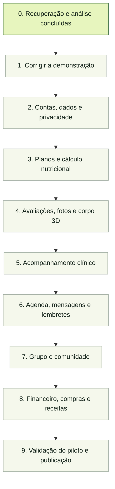

# Nutrilume — roteiro visual

Atualizado em 17/10/2026. Este é o roteiro geral proposto para transformar a demonstração em uma plataforma de acompanhamento nutricional. O visual atual será preservado como base. A prioridade inclui evolução corporal em 3D, opcional e privada para o paciente e seu nutricionista responsável.

Este documento acompanha entregas reais: planejamento não significa implementação concluída. Cada etapa terá tarefas menores, critérios de validação e links para as alterações correspondentes. Escolhas de backend, hospedagem, processamento 3D e provedor de WhatsApp serão registradas antes de suas integrações.

## Visão geral

Testes, acessibilidade, revisão de permissões e documentação acompanham todas as etapas. A etapa final verifica a plataforma integrada e não concentra toda a qualidade no fim.

## Quadro de acompanhamento

| Etapa | Estado atual | Entrega que poderá ser conferida |
| --- | --- | --- |
| 0. Recuperar e analisar | Concluído | Código no GitHub, 103 verificações aprovadas e cinco issues abertas |
| 1. Corrigir a demonstração | Planejado | Cálculos coerentes, paciente correto, metas por data e interface ajustada |
| 2. Contas, dados e privacidade | Planejado | Dados salvos entre acessos e separados por conta |
| 3. Planos e nutrição | Planejado | Planos versionados e cálculo rastreável com indicação de totais parciais |
| 4. Avaliações e 3D privado | Planejado | Histórico de medidas e comparação corporal entre avaliações |
| 5. Acompanhamento clínico | Planejado | Diário, ficha e hábitos organizados no histórico do paciente |
| 6. Atendimento e comunicação | Planejado | Agenda editável, mensagens entre contas e lembretes acompanháveis |
| 7. Espaços coletivos | Planejado | Salas e moderação com permissões e alertas separados |
| 8. Gestão e utilidades | Planejado | Financeiro por lançamentos, compras por período e receitas calculadas |
| 9. Piloto e publicação | Planejado | Fluxos completos conferidos e instruções de operação |

Estados: **Planejado → Em andamento → Em validação → Concluído**. Se faltar uma decisão, credencial ou acesso, a tarefa será marcada como **Bloqueada**, com o motivo. Uma etapa só fica concluída com sua entrega implementada e verificada.

## Entregas por etapa

### 1. Corrigir a demonstração

- [ ] Invalidar ou recalcular os macros quando o alimento mudar — issue #1.
- [ ] Separar plano e rascunho por paciente e identificar o destinatário — issue #2.
- [ ] Registrar a meta por data, impedir duplicidade e permitir desfazer — issue #4.
- [ ] Sincronizar nomes de perfil e corrigir o transbordamento no celular — issue #5.
- [ ] Atualizar diretrizes visuais e tornar falhas dos testes detectáveis pela automação.

**Validação:** reproduzir os problemas e demonstrar que foram corrigidos, mantendo os fluxos existentes.

### 2. Contas, dados e privacidade

- [ ] Definir arquitetura e serviços com custos e limites documentados.
- [ ] Implementar cadastro, login, recuperação de acesso e vínculo profissional–paciente.
- [ ] Persistir dados com identificadores estáveis e separar acesso no servidor — issue #3.
- [ ] Criar convites reais, com validade e uso único.
- [ ] Registrar consentimentos e aplicar escolhas de fotos, grupo e modelo corporal.
- [ ] Proteger arquivos, registrar acessos relevantes e definir backup, retenção e exclusão.

**Validação:** testar contas diferentes, acesso sem autorização, recarregamento, saída e retorno à conta. Fotos e modelos corporais não terão acesso público.

### 3. Planos e cálculo nutricional

- [ ] Guardar versões publicadas e separar escolhas do paciente da prescrição original.
- [ ] Identificar itens sem cálculo e apresentar totais parciais corretamente.
- [ ] Definir arredondamento e vínculo entre alimento, preparo, quantidade e nutrientes.
- [ ] Importar base nutricional com fonte e versão e revisar conversões de medidas caseiras.
- [ ] Definir com o profissional a apresentação de nutrientes ao paciente.

**Validação:** conferir cálculos conhecidos, alterações, publicação, recuperação de versões e isolamento entre pacientes. Validação clínica da base precisa da participação de um nutricionista.

### 4. Avaliações, fotos e corpo 3D privado

- [ ] Cadastrar avaliações por data e histórico de medidas, com registro de correções.
- [ ] Integrar fotos privadas ao acompanhamento, respeitando o consentimento.
- [ ] Comparar abordagens de 3D: modelo estimado por medidas, reconstrução por fotos e captura por escaneamento.
- [ ] Realizar uma prova de viabilidade do método escolhido antes da integração definitiva.
- [ ] Criar visualização com rotação, aproximação e comparação entre duas avaliações.
- [ ] Informar o grau de estimativa do modelo e detectar entradas insuficientes ou inválidas.
- [ ] Implementar autorização específica, revogação e tratamento dos arquivos e modelos após exclusão ou encerramento do vínculo.

**Proposta inicial:** avaliar primeiro um modelo 3D estimado por medidas. Esse método facilita a primeira versão, mas não reproduz com exatidão o corpo real. Se o objetivo exigir uma reconstrução mais fiel, a prova de viabilidade deve avaliar captura padronizada por imagens ou escaneamento. Essa decisão continua aberta.

**Validação:** paciente e nutricionista responsável acessam o modelo; outras contas não acessam. Recusar o 3D mantém as demais funções disponíveis. Conferir comparação por data, permissões revogadas e comportamento em celulares.

### 5. Acompanhamento clínico

- [ ] Disponibilizar diário e ficha ao profissional responsável, por data.
- [ ] Guardar alterações da ficha e organizar informações relevantes, como alergias.
- [ ] Persistir água, refeições e hábitos por dia, com semana e fuso definidos.
- [ ] Criar resumo de acompanhamento e pendências do paciente.

**Validação:** paciente registra; o profissional correto consulta; o histórico permanece íntegro entre acessos.

### 6. Agenda, mensagens e lembretes

- [ ] Criar, reagendar e cancelar consultas; verificar conflitos e registrar comparecimento.
- [ ] Implementar mensagens entre contas e anexos privados para exames.
- [ ] Definir preferência de canal e horário de lembretes.
- [ ] Integrar WhatsApp e notificações com controle de duplicidade e estados de envio.
- [ ] Atualizar ou cancelar lembretes quando a consulta mudar e registrar falhas.

**Validação:** percorrer o agendamento até o lembrete e testar reagendamento, falha de entrega e acesso aos anexos. A entrega real por serviço externo depende da integração e das credenciais correspondentes.

### 7. Grupo e comunidade

- [ ] Aplicar permissões e moderação no servidor.
- [ ] Separar alertas e denúncias por sala e anfitrião.
- [ ] Definir revisão de denúncias, bloqueios e exclusão de mensagens.
- [ ] Implementar o processo de verificação profissional antes de exibir CRN conferido.
- [ ] Preservar a separação entre acompanhamento clínico privado e participação comunitária.

**Validação:** verificar papéis distintos, limites de publicação e acesso a denúncias e alertas de outras salas.

### 8. Financeiro, compras e receitas

- [ ] Cadastrar cobranças, vencimentos, pagamentos e cancelamentos por paciente ou consulta.
- [ ] Calcular o painel financeiro a partir dos lançamentos.
- [ ] Calcular compras por período, frequência e quantidade, com conversões consistentes.
- [ ] Cadastrar receitas com ingredientes, rendimento, porções e nutrientes.

**Validação:** conferir somas, duplicidades, alterações de período e cálculo por porção. Integração para cobrar pagamentos é uma escolha separada do controle financeiro.

### 9. Validação do piloto e publicação

- [ ] Automatizar testes essenciais no GitHub e revisar os fluxos completos.
- [ ] Conferir acessibilidade, foco em modais, desempenho e falhas de rede.
- [ ] Testar instalação, atualização e notificações em aparelhos reais.
- [ ] Validar backup, recuperação e exclusão de dados.
- [ ] Preparar ambiente de teste e documentação de operação.
- [ ] Fazer revisão clínica e das regras aplicáveis antes de um piloto com dados reais.
- [ ] Registrar limitações conhecidas e publicar a versão validada.

**Validação:** executar o fluxo de convite e consentimento até plano, acompanhamento, avaliação 3D e consulta, com contas distintas e permissões conferidas.

## Como acompanhar o trabalho

Em cada entrega, o registro terá:

| Campo | Informação |
| --- | --- |
| Fazendo agora | Tarefa específica em execução |
| Mudança visível | O que muda para paciente ou nutricionista |
| Conferência | Fluxos e testes executados, com resultado |
| Evidência | Issue, commit e captura ou demonstração quando útil |
| Próximo passo | Próxima tarefa e dependências |

Não há prazo fechado nem percentual global nesta fase. O avanço será medido por entregas verificadas; esforço, custos e dependências serão refinados por módulo. O roteiro não executa tarefas em segundo plano.
