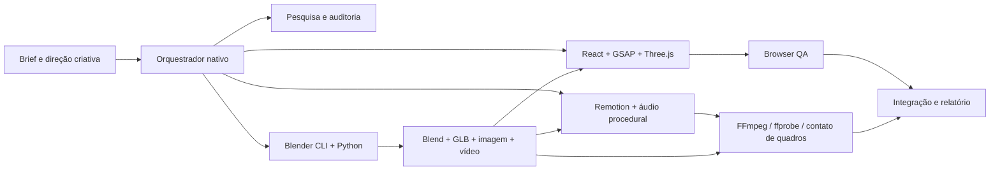

# Arquitetura escolhida

O estúdio usa a orquestração nativa disponível nesta sessão e contratos em arquivos. Superpowers e BMAD são referências de processo; OpenAI Agents SDK, CrewAI e Deep Agents são alternativas auditadas, não três runtimes instalados simultaneamente. Não há chamada a modelo externo ou consumo de API pago configurado pelo projeto.

## Pipeline principal

A stack web evita instalar R3F/Drei por obrigação quando Three.js direto resolve o projeto. Seus padrões e casos de uso são documentados na auditoria 3D para migração futura. Remotion gera vídeo programático; Blender gera cena/render 3D. Nenhum desses processos equivale a geração de vídeo por um modelo de IA.

## Persistência e contexto

O código, os briefs, as decisões e as evidências ficam neste projeto. Cada especialista escreve em sua pasta. O arquivo docs/STATUS.md e o relatório final fazem o papel de memória operacional recuperável. Os agentes existem durante suas tarefas; os doze perfis não são doze servidores permanentes.

## Render e capacidade

Ambiente observado: Blender4.3.2, FFmpeg7.1.5, Node24.19, Python3.12.14, Chromium151 via Playwright e três CPUs visíveis e quota efetiva de duas. Não presumir GPU nem WebGPU só pela presença de bibliotecas. Usar render de amostra limitada e concorrência controlada. Comparar resultados de software e GPU real como capacidades distintas.

## Integração Blender

CLI headless e scripts Python próprios são a integração inicial, sem socket de execução arbitrária. Blender MCP é avaliado separadamente; não é necessário abri-lo para criar .blend/.glb e renderizar. A decisão de não ativá-lo reduz superfície de execução e dependências sem impedir a entrega.

## Distribuição

Entrega local sem hospedagem ou contas novas. A disponibilização de um projeto não remove obrigações das licenças de suas dependências; GSAP e Remotion devem ser descritos pelas licenças verificadas, não chamados genericamente de MIT. Assets originais não dependem de um acervo de terceiros.
