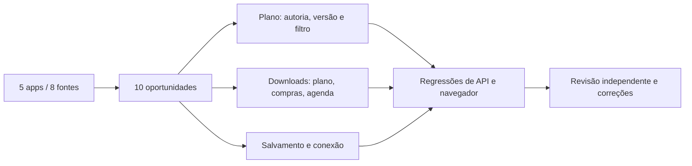

# Implementação das melhorias de usabilidade

Base: [pesquisa pública de cinco apps](../PESQUISA-APPS.md). Objetivo autorizado: aplicar ideias úteis sem contratação, mantendo autoria nutricional e privacidade. Execução nativa com delegação limitada dos serializers e revisão independente.

Arquivos: `platform/exports.js` serializa somente campos permitidos; `platform/app.js` integra controles/downloads e preserva contexto; `platform/api.js` comunica falha de conexão; `platform/styles.css` trata foco/safe area; `server/care.mjs` fornece origem da lista na própria resposta que calcula suas quantidades.

Critérios: filtro não muda prescrição e exporta plano completo; downloads não incluem senhas/tokens ou observações no calendário; data e timezone são explícitos; falha de rede não vira sucesso nem apaga texto da mesma tela; resposta atrasada não substitui texto de outro paciente. JSON de plano não é backup integral da conta e não oferece importação automática.

Validação: testes dos serializers escritos antes do módulo (RED por módulo ausente, depois9verificações GREEN); fluxo de navegador novo observado falhar no cabeçalho ausente antes da UI; revisão identificou origem de compras e retorno tardio de formulário, com cenários de regressão adicionais. Evidências finais e limites em [VALIDACAO.md](../VALIDACAO.md).

Não criar associação de receita pelo nome: ainda falta vínculo estável entre receita e item prescrito. Scanner, TACO completa, fila clínica offline e exportação integral da conta continuam como propostas, sem anúncio de implementação. Nenhum dado clínico é persistido no service worker/localStorage para facilitar esses atalhos.
